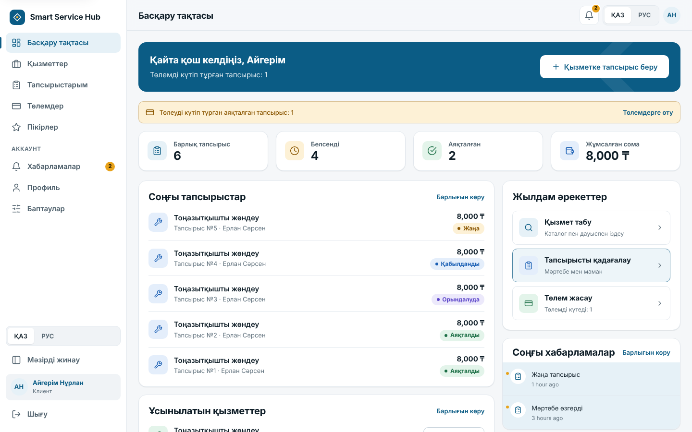
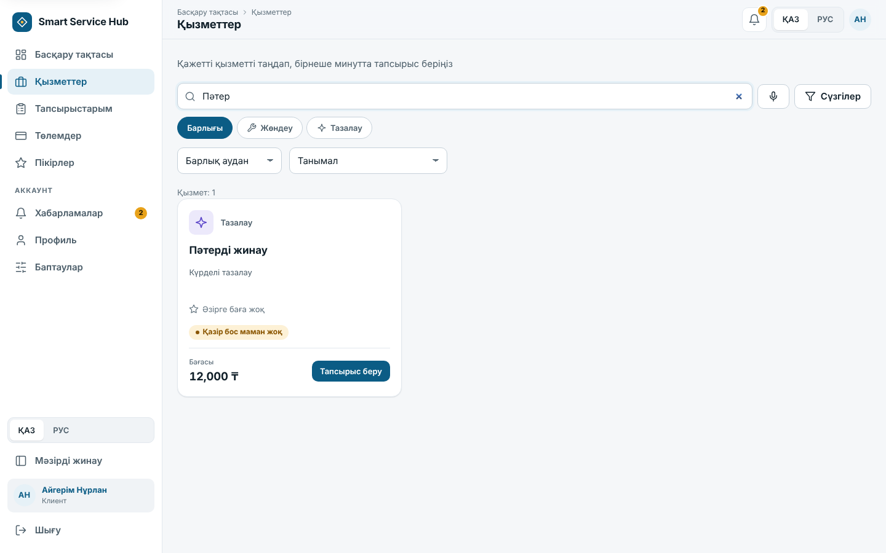
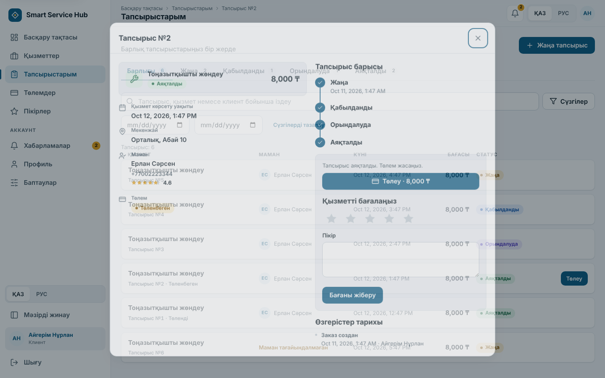
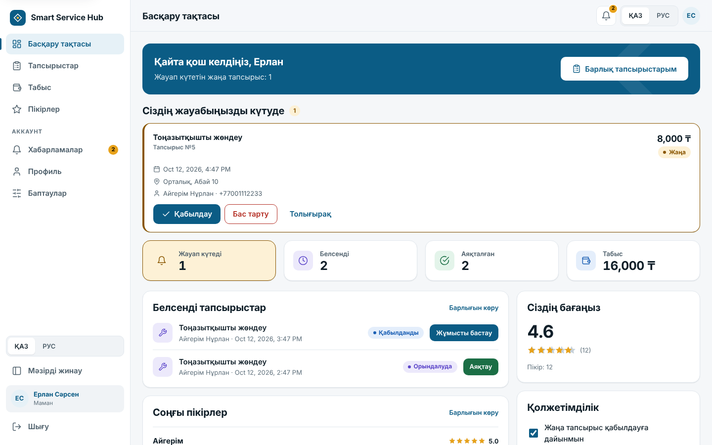
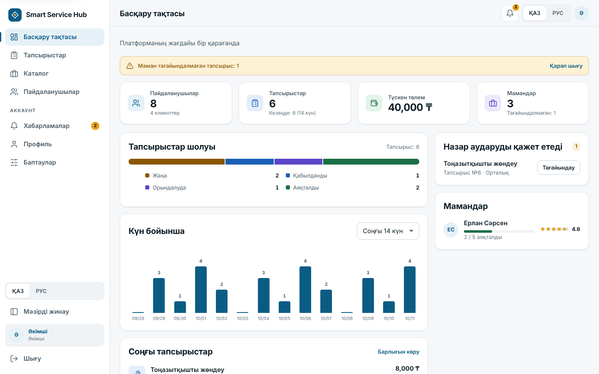
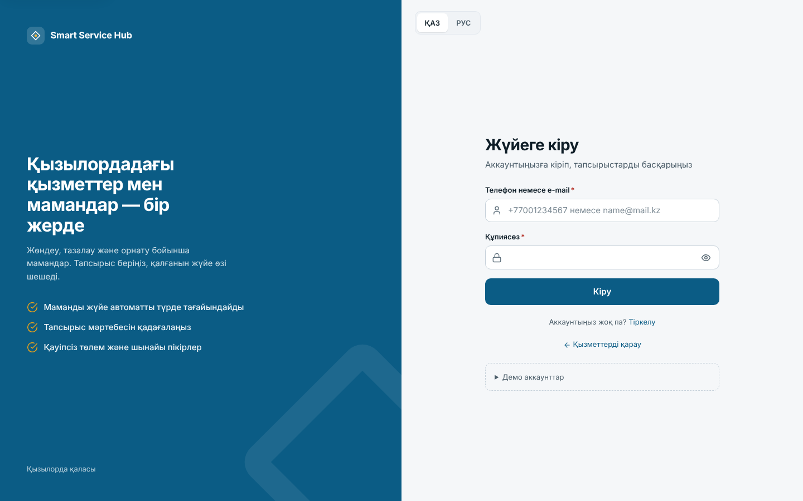
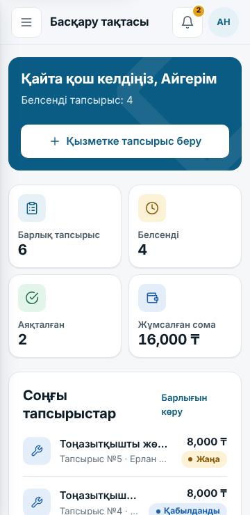
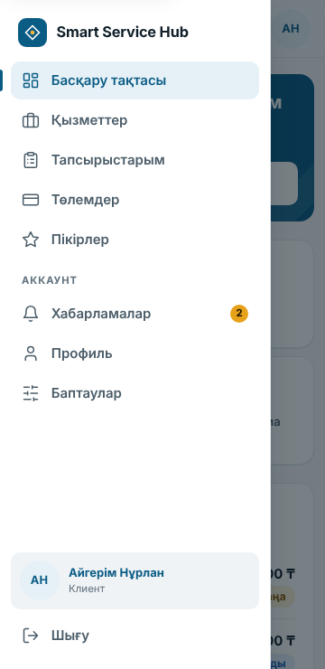
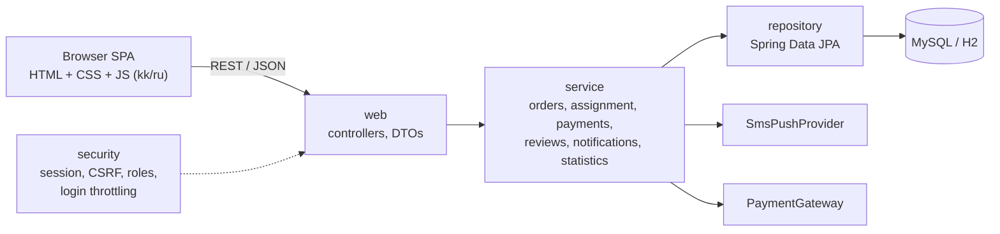

# Smart Service Hub


An online platform that connects clients with home and technical service providers (repair, cleaning, installation) in
Kyzylorda, Kazakhstan. A client picks a service and books it; the system automatically assigns the best available
specialist, the specialist works the order through its lifecycle, and the client pays and leaves a review.

The interface is available in **Kazakh and Russian**. Built as a coursework project (Information Systems), then
reworked into a portfolio-grade application: redesigned frontend, hardened backend, test suite.

## Screenshots

| Client dashboard | Services |
| --- | --- |
|  |  |

| Order details | Specialist dashboard |
| --- | --- |
|  |  |

| Admin dashboard | Sign in |
| --- | --- |
|  |  |

| Mobile (360 px) | Mobile drawer |
| --- | --- |
|  |  |

*Screenshots show the interface with sample data.*

## Features

- **Service catalog** with text and voice search (Web Speech API), category filter, sorting, ratings and availability.
- **Automatic specialist assignment** by category, free time slot (±2 h), district, rating and current load.
  Concurrent bookings are serialised so one specialist is never double-booked.
- **Order lifecycle** `New → Accepted → In progress → Completed` with a full audit trail (who changed what and when).
- **Rejections do not strand orders**: when a specialist declines, the order is re-assigned to someone else (never to
  a specialist who already declined it); if nobody is free, the administrators are alerted.
- **Payments** through a pluggable gateway (a mock gateway is included). A duplicate payment for an order is impossible
  at the database level.
- **Reviews** that update the specialist's rating.
- **Notification center** (in-app, with SMS/push provider abstraction; delivery never blocks or breaks a business
  operation).
- **Administration**: catalog management, user blocking, manual assignment, statistics dashboard.
- **Responsive, accessible UI**: sidebar + drawer, light/dark theme, keyboard navigation, focus management, 44 px
  touch targets, no external fonts or CDNs (works offline).

## Roles

| Role | Can do |
| --- | --- |
| **Client** | Browse and search services, place orders, follow status, pay, review, read notifications |
| **Specialist** | See assigned orders (pending actions first), accept / reject, advance status, manage profile and availability, see earnings and reviews |
| **Administrator** | Manage categories, services and users, monitor all orders, assign specialists manually, view statistics |

Administrators cannot self-register; see [Configuration](#configuration) for creating the first one.

## Tech stack

| Layer | Technology |
| --- | --- |
| Backend | Java 17, Spring Boot 3.5 (Web, Data JPA, Security, Validation) |
| Database | MySQL 8 (production), H2 (demo / tests) |
| Frontend | HTML, CSS (design tokens), vanilla JavaScript SPA (hash router, no framework, no build step) |
| Auth | Server-side session (`JSESSIONID`, HttpOnly), BCrypt, CSRF double-submit cookie |
| Tests | JUnit 5, Mockito, Spring Boot Test / MockMvc |
| Packaging | Maven, Docker / Docker Compose, optional Windows desktop launcher |

## Architecture



Layered **Controller → Service → Repository**. Business rules live in the service layer; controllers only map HTTP to
service calls. External systems (payments, SMS) sit behind interfaces so they can be replaced without touching the
business code. More diagrams: [`docs/diagrams`](docs/diagrams) (architecture, ER, order status flow).

Two design decisions worth knowing:

- **Payments run in three short steps** (reserve → charge → settle) instead of one long transaction, so a slow
  gateway never holds a database connection. The reservation inserts a `PENDING` row whose `active_order_id` column
  is `UNIQUE`; a second concurrent payment therefore fails in the database itself, not just in application code.
- **Assignment takes a row lock on the candidate specialists** (`SELECT … FOR UPDATE`, fixed id order to avoid
  deadlocks) before checking their free time, so two simultaneous orders queue up instead of both seeing the same
  specialist as free.

## Getting started

### Requirements

- JDK 17 or newer, Maven 3.9+
- MySQL 8 (or Docker) for a real database; **not needed for the demo mode**

### Quick demo (no database, 1 minute)

```bash
mvn spring-boot:run -Dspring-boot.run.profiles=h2
```

Open <http://localhost:8080>. The in-memory H2 database is filled with sample data (categories, services, specialists,
orders). On `localhost` the sign-in page offers one-click demo accounts; they are never shown on other hosts. Data is
lost when the application stops.

### With Docker (MySQL + application)

```bash
cp .env.example .env        # set DB_PASSWORD; set APP_SEED_ENABLED=true if you want sample data
docker compose up --build
```

Open <http://localhost:8080>. MySQL is bound to `127.0.0.1` only.

### With your own MySQL

```bash
export DB_PASSWORD=...      # required: the application refuses to start without it
export APP_SEED_ENABLED=true   # optional: sample data in an empty database
mvn spring-boot:run
```

### Windows desktop app (optional)

A small launcher runs the server and opens the UI in its own window, storing data under
`%USERPROFILE%\.smart-service-hub` (H2, no MySQL):

```bash
mvn clean package -DskipTests
run-desktop.bat          # needs Java installed
build-desktop.bat        # standalone dist\SmartServiceHub\SmartServiceHub.exe
```

## Configuration

Everything is configured through environment variables; nothing secret is stored in the repository.
Copy [`.env.example`](.env.example) to `.env` (git-ignored) for local use.

| Variable | Default | Purpose |
| --- | --- | --- |
| `DB_URL` | built from the parts below | Full JDBC URL (overrides the parts) |
| `DB_HOST` / `DB_PORT` / `DB_NAME` | `localhost` / `3306` / `smart_service_hub` | MySQL location |
| `DB_USERNAME` | `root` | Database user |
| `DB_PASSWORD` | *none* | Database password. **Required** for MySQL |
| `DDL_AUTO` | `update` (`validate` in `prod`) | Hibernate schema mode |
| `APP_SEED_ENABLED` | `false` | Load sample data (with publicly known demo passwords) into an **empty** database |
| `APP_ADMIN_PHONE`, `APP_ADMIN_PASSWORD` | empty | Create the first administrator on a fresh database (also `APP_ADMIN_EMAIL`, `APP_ADMIN_NAME`) |
| `SESSION_COOKIE_SECURE` | `false` | Send the session cookie over HTTPS only (the `prod` profile turns it on) |
| `PORT` | `8080` | HTTP port |

Spring profiles: `h2` (in-memory demo), `desktop` (file H2), `prod` (secure cookies, schema validation, seeding off).

### Database setup

- **Development:** nothing to do; `DDL_AUTO=update` creates and extends tables.
- **Production:** create the schema from [`database/schema.sql`](database/schema.sql), run with
  `--spring.profiles.active=prod` (Hibernate then only validates the schema), and create the first administrator
  with `APP_ADMIN_PHONE` / `APP_ADMIN_PASSWORD` (minimum 10 characters), then remove those variables.
- **Upgrading an older database:** apply [`database/migrations`](database/migrations) in order.

## Project structure

```
├── pom.xml, Dockerfile, docker-compose.yml, .env.example
├── database/
│   ├── schema.sql                 # MySQL schema
│   └── migrations/                # upgrade scripts for existing databases
├── docs/                          # API, diagrams, requirements, use cases, screenshots
└── src/
    ├── main/java/kz/smarthub/
    │   ├── web/                   # REST controllers, DTOs, error handling
    │   ├── service/               # business logic (orders, assignment, payments, ...)
    │   ├── repository/            # Spring Data JPA repositories
    │   ├── domain/                # JPA entities and enums
    │   ├── security/              # user details, CSRF filter, login throttling
    │   ├── integration/           # PaymentGateway, SmsPushProvider (+ mock/logging implementations)
    │   ├── config/                # security, demo data, first-admin bootstrap
    │   └── desktop/               # optional Windows launcher
    ├── main/resources/
    │   ├── application*.properties
    │   └── static/                # the SPA: index.html, css/ (tokens + components), js/ (core, ui, pages-*, i18n)
    └── test/java/kz/smarthub/     # unit and integration tests
```

## API overview

JSON over HTTP, session cookie authentication, errors as `{"message": "<kk>||<ru>"}`. State-changing requests must
send the `X-XSRF-TOKEN` header (the SPA does this automatically). Full reference: [`docs/api.md`](docs/api.md).

| Area | Endpoints |
| --- | --- |
| Auth | `POST /api/auth/register`, `/login`, `/logout`; `GET /api/auth/me` |
| Catalog (public) | `GET /api/catalog/categories`, `/services?categoryId=&q=`, `/districts` |
| Client | `POST/GET /api/client/orders`, `POST /api/client/orders/{id}/pay`, `/review` |
| Specialist | `GET /api/worker/orders`, `POST …/{id}/accept`, `/reject`, `/status`; `GET/PUT /api/worker/profile`; `GET /api/worker/reviews` |
| Shared | `GET /api/orders/{id}`, `GET /api/notifications`, `POST /api/notifications/read-all` |
| Admin | `/api/admin/orders`, `…/{id}/candidates`, `…/{id}/assign`, `/categories`, `/services`, `/users`, `/stats` |

## Testing

```bash
mvn test
```

66 tests, no external services required (integration tests use in-memory H2):

- **Order lifecycle:** status chain (no skipping or going back), ownership, price snapshot, visibility rules.
- **Specialist assignment:** district, rating, load and id tie-breaking, overlapping orders, exclusions, single load query.
- **Rejections:** re-assignment to another specialist, escalation when nobody is free, accepted orders cannot be rejected.
- **Payments:** one paid record per order, failed/crashed gateway frees the order for retry, in-flight and abandoned
  payments, only the owner can pay, **database-level** refusal of a second live payment.
- **Security:** endpoints require login, role separation, CSRF enforcement, login throttling (per account and per
  address), session id rotation on login, first-admin bootstrap rules.
- **Notifications:** SMS/push is sent only after commit, never on rollback, and a failing provider cannot break an order.
- **Catalog:** rating and availability on service cards.
- **End to end (MockMvc):** booking → assignment → status chain → payment → review.

## Security notes

- Passwords are stored as BCrypt hashes; the hash never leaves the server.
- Sessions are server-side, cookie is `HttpOnly`, `SameSite=Lax`, and `Secure` in production. The session id is
  rotated on login (session fixation).
- CSRF protection via double-submit cookie (`XSRF-TOKEN` → `X-XSRF-TOKEN`).
- Login brute-force protection: 5 failures per (address, account) and 20 per address within 15 minutes lock further
  attempts (HTTP 429). The counters are in memory, so a multi-instance deployment should move them to a shared store.
- Authorization is enforced by URL role rules **and** ownership checks in the service layer.
- No default credentials exist in the code path used in production: demo data is off unless `APP_SEED_ENABLED=true`,
  and the first administrator comes from environment variables.
- Error responses never include stack traces or internal messages; the UI escapes all dynamic content.
- Terminate TLS in a reverse proxy (or configure `server.ssl.*`) and set `server.forward-headers-strategy=framework`
  behind a proxy so the real client address is used for throttling.
- The card form is a **demo**: the mock gateway accepts any 16 digits (numbers starting with `4000` are declined) and
  only the last four digits are kept. Use a PCI-compliant provider (hosted fields / redirect) for real money.

## Known limitations and future improvements

- No `Cancelled` order status; clients cannot cancel or reschedule an order yet.
- Service duration is informational only (optional `durationMinutes`); the assignment window is still a fixed ±2 hours and does not use it. Card rating and availability are derived per category.
- A specialist has a single specialization and district; the free-slot window is a fixed ±2 hours.
- Real SMS and payment providers are not integrated (interfaces and mock implementations only).
- Login throttling is per instance; add a shared store and a database migration tool (Flyway) for production.
- OpenAPI/Swagger documentation and frontend end-to-end tests (Playwright).

## License

No license has been chosen yet. Add one (for example MIT) before publishing if you want others to reuse the code.
